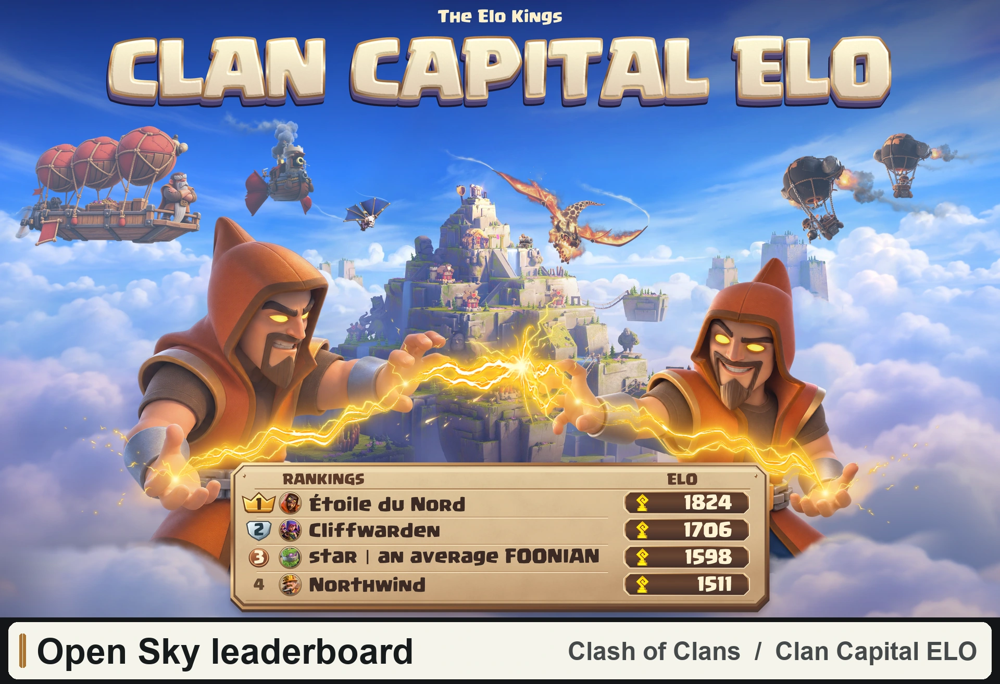

# Graphic Design Harness

Six skills for directing an AI design agent through a collection. Give it the brief, compare drafts on the actual artwork, and choose what advances. Each piece has its own plan and editable master, with shared art direction across the set.

## Showcase

Two community tournaments, from the opening announcement to the final score. The **Clan Capital ELO** series stages its matches above a Clash of Clans valley. The **CS:GO After Hours Cup** uses the Hotel Aurore street on Dust II to tie three Discord cards together.

<picture>
  <source media="(prefers-reduced-motion: reduce)" srcset="examples/showcase/open-sky.jpg">
  
</picture>

<details>
<summary>View each graphic at your own pace</summary>

- **Clan Capital ELO** · [Open Sky leaderboard](examples/showcase/open-sky.jpg) · [Head-to-head](examples/showcase/head-to-head.jpg) · [Bracket](examples/showcase/bracket.jpg) · [Finals scoreboard](examples/showcase/scoreboard.jpg) · [4–2 result](examples/showcase/match-result.jpg)
- **CS:GO After Hours Cup** · [Announcement](examples/csgo/poster.png) · [Revised matchup](examples/csgo/matchup-spacing.png) · [Winner](examples/csgo/winner.png)

</details>

The Clan Capital artwork is unofficial fan content. Supercell does not endorse it. [Supercell Fan Content Policy](https://supercell.com/en/fan-content-policy/)

## Install and start

From the project where you want to make graphics, run this once. It installs all six skills for Codex, Claude Code, Google Antigravity and Cursor. Use Node.js 22.20+ for the installer and uv for the studio tools. On Windows, run the studio tools in WSL. [Install Node.js](https://nodejs.org/en/download) · [Install uv](https://docs.astral.sh/uv/getting-started/installation/)

```sh
npx --yes skills@1.9.0 add jamestesting0/graphic-design --skill '*' --agent codex claude-code antigravity cursor -y
```

Open a fresh agent session in that project and say:

> Use setup-design-studio. My friends are having a game night. Make a Discord poster, a matchup card and a winner card. Show me two ideas and I’ll pick.

The agent creates `.graphic-design/studio.md`, a collection board with one plan per graphic. You can attach a favorite image or an exact team logo, or leave asset sourcing to the designer. To install for just one agent, keep only its name after `--agent`. Add `--global` for a user-wide installation. To update the six skills, rerun the same install command. [Installer options and supported agents](https://github.com/vercel-labs/skills)

### Standalone studio command

For a terminal workflow, install the Python package directly from GitHub. It includes the six skills, the review scripts and the `graphic-design` executable with its Pillow dependency.

```sh
uv tool install git+https://github.com/jamestesting0/graphic-design.git
graphic-design init --intent "Community tournament night" poster matchup winner
graphic-design status
```

`graphic-design skills-path` prints the bundled skill directory. For another Agent Skills-compatible host, copy the six directories from there to its documented skills location. Each skill carries its own instructions and assets. Agents need local file and command access for the studio workflow. [Agent Skills format](https://agentskills.io/specification) · [Studio command guide](.agents/skills/setup-design-studio/references/commands.md)

## From brief to delivery

- **Give each reference a job.** Use original game art for character proportions, a favorite poster for dramatic staging, and a real Discord screenshot for scale. Record which qualities the user wants to borrow.
- **Prove the scene before adding effects.** Hide the lightning to check whether the wizards still appear to aim at each other. Keep a crossing cloud on its own layer so the robe stays intact behind it. Finish with local light, motion or music as the piece requires.
- **Review the way the audience will use it.** Inspect edges at full resolution, then follow the longest player name through the bracket at posted size. Clear the scoreboard and check that its stars survive. [Review examples](examples/review-lab.md)
- **Compare drafts blind.** Show the same crop and scale under neutral labels before revealing the maker’s preference. Two reviewers favored different palm reflections this way; the gallery kept both versions and the reason for the final choice. [Session notes](examples/session-audit.md)
- **Keep every decision recoverable.** The studio board distinguishes working drafts, approvals and shipped versions. Reopen an earlier composition while the delivered edition stays available.

## Start a collection

Describe the first piece you want to make. The [studio guide](AGENTS.md) explains how the six skills work together.

> I want to make a poster for our Clash of Clans tournament in Clan Capital. We’ll announce it on Discord, then use the same look for matchup cards and a leaderboard. I’ve attached the game art and a screenshot of our channel. I picture two Super Wizards facing off above the valley. Can you show me a wide shot and a close-up in the Discord preview, with the tournament name and date in place? Let’s pick the poster direction first.

You can also start with no artwork, attach a file later, or give the agent a link and say “use this exact badge.” The agent files it in the studio library and tracks where it is used. In the [CS:GO organizer trial](examples/csgo/README.md), the designer found the game scene, compared two poster ideas and incorporated a team badge supplied later. See the first exports, the independent review and the revised collection.
