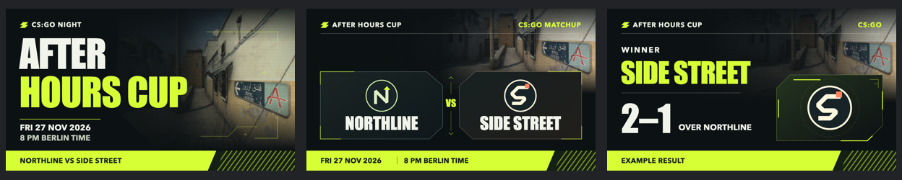
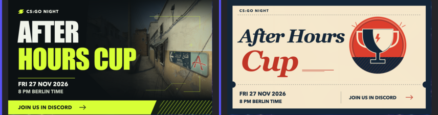

# After Hours Cup · CS:GO commission trial

[Announcement poster](poster.png) · [Matchup](matchup.png) · [Example winner](winner.png) · [Editable studio](studio.zip)

**Later organizer feedback.** The delivered matchup left a dark gap above the viewer-left team. The [spacing study](spacing.md) compares four treatments at Discord size. The [revised head-to-head](matchup-spacing.png) is the working version in the studio; the delivery above records the original trial.

## The organizer’s request

> My friends and I are having a CS:GO night. Could you make a poster for Discord, a card showing who’s playing, and one for the winner? I want it to feel like a real tournament. Show me a couple of ideas and I’ll pick.

A production agent received this brief and the portable harness. A second agent reviewed the rendered set without the designer’s explanation. Codex played the organizer for this exercise. The event, team names and example result are fictional.

The designer asked for the event name, time, teams and an example outcome. The organizer supplied After Hours Cup, Friday 27 November 2026 at 8 pm Berlin time, Northline versus Side Street, with Side Street winning 2–1 in the example. The organizer provided no game pictures and asked the designer to find one. A [team badge](organizer/side-street.svg) was held back until the choice of direction to exercise a late delivery. This original fixture can be used and redistributed with the example.

## What the trial measures

Before seeing the candidates, we set four viewing tasks. At a simulated 360-pixel Discord attachment width, identify the event and time on the poster, both opponents on the matchup, and the winner and score on the result. Seen together, the three should feel like the same event. The reviewer also inspects the graphics at native size and reports their strongest aesthetic objection. The organizer judges appeal, supplies event facts and selects an idea. Asset research, typography, composition, export settings and technical repairs belong to the designer.

For asset handling, trace one designer-found asset and one organizer-supplied original from receipt to use. Check whether the late badge preserves its identifying features, appears on the applicable pieces, and leaves an unrelated approved design decision intact.

## The creative decision

The designer inspected seven scenes from Valve’s CS:GO Dust II comparison and chose the street with the Hotel Aurore sign. The second option used an original trophy illustration. The organizer chose A with “My friends will recognize that street,” then asked to use Side Street’s exact badge on the matchup and winner cards. This settled the look of the collection without a conversation about typefaces, cropping or color values. [Valve’s Dust II study](https://www.counter-strike.net/dust2/)

## What the first review caught

The reviewer opened three unlabeled 360-pixel graphics before receiving the expected facts. They correctly read the game from the poster, the date and time, both teams, and Side Street’s example 2–1 win over Northline. The fluorescent type and dark street made the three look related. [First exports at posted size](first-pass.png)

The matchup and winner both included the correct background file, but their panels covered almost the entire red A beside the hotel sign. The reviewer could identify the game from the set as a whole and struggled on those two individual posts. The poster passed their visual review. A separate check of how the poster would be used caught “Join us in Discord →” on a static image intended for people already in the server. Both problems could survive a checklist for correct text, matching colors and present assets.

## Second pass and verdict

The designer kept the chosen palette, team identities and type hierarchy, lowered the panels to reveal the sign, named CS:GO on both cards, and replaced the poster’s invitation with the team names. The same reviewer opened each revised image individually at 360 pixels, then swept all 12 native-size tiles. All three advanced. The closest call is the matchup panel approaching the sign’s shadow. The red letter and sign face stay clear. The result card reads as an example throughout.

The set works as a small community tournament package. The street gives it a sense of place, the opponents have equal visual weight, and the result reads immediately. The chartreuse bars and angular panels are familiar esports styling; the map crop and supplied badge carry much of the identity. A simulated organizer and two AI agents exercised this workflow. Professional audience preference, a real novice’s experience and live Discord rendering remain unmeasured.

## What changed in the harness

- **Carry the reason for a selection into production.** Record what the organizer recognized or liked. Review each independently posted piece at its smallest intended size before revealing the family or expected answers. Check whether a suggested action makes sense where it will appear.
- **Let the designer own asset sourcing.** Start with what the user supplies, research missing materials, and register the original, source, use and affected graphics. Here the map was found, the Side Street badge arrived later, and the Northline emblem was drawn for the event. The supplied SVG matches the two production copies byte for byte. The studio’s dependency records identify those two graphics as consumers.
- **Establish that the renderer repeats before judging protected pixels.** An unchanged first-pass poster varied by one red-channel level on three type-edge pixels. The designer switched both comparison renders to software rendering. All final SVGs reproduced their saved exports on the test Mac. A separate score edit and badge visibility edit preserved pixels outside the intended area.

## Open the studio

The PNGs above are ready to view at 1600 × 900. Unpack the studio and open `.graphic-design/studio.md` for both designs, the version history, asset register, review decisions and local delivery. The `checks/` folder contains the independent per-tile records for both review passes (X = winner, Y = poster, Z = matchup).

The original trial restored the verified Valve source at 11 library, version and release locations. The archive now includes two additional spacing studies. A fresh extraction restored all 13 locations, verified every saved version and reproduced the new matchup candidate pixel for pixel. The three original delivery masters also reproduced their posted PNGs on the test Mac.

Before editing, run `python3 restore_map.py` from the extracted folder. It retrieves Valve’s original once and verifies its SHA-256 before filling the working locations. Open a copy of the chosen `master.svg` with its adjacent `art/` folder, or run `sh render.sh .` from that copy. The tested renderer uses Chrome and macOS fonts. The archive includes the organizer’s badge, both draft directions and the composed fan artwork. The Valve source JPEG is fetched from the publisher. This example was prepared for a noncommercial community event. [Valve’s game content terms, section 2.D](https://store.steampowered.com/subscriber_agreement/#2)
