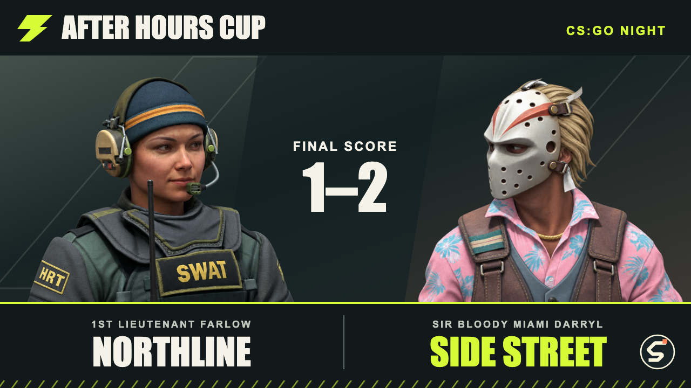
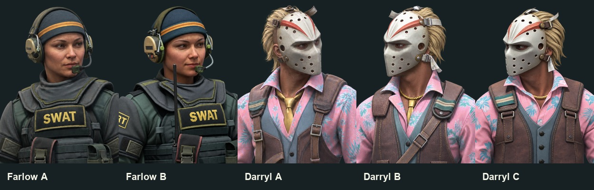

# Two CS:GO portraits and a round-end cue

**Trial brief.** Make Northline and Side Street face each other on an After Hours Cup card. Use Farlow and Miami Darryl as the teams’ characters. Give Side Street an example 2–1 win and a short metallic gong when the result appears.

[Farlow cutout](farlow.png) · [Darryl cutout](darryl.png) · [Round-end clip](round-end.mp4) · [Isolated gong](round-end.wav)

## What changed across five generations

Valve’s 397 × 700 character renders supplied the identity and wardrobe. The portraits change the pose and framing for this fan tournament. Open the references alongside the study sheet to compare the characters at head scale. [Operation Broken Fang](https://www.counter-strike.net/brokenfang) · [Original Farlow](https://cdn.fastly.steamstatic.com/apps/csgo/images/brokenfang/farlow.png) · [Original Miami Darryl](https://cdn.fastly.steamstatic.com/apps/csgo/images/brokenfang/darryl_miami.png)

| Candidate | Construction against the original | Decision in the card |
| --- | --- | --- |
| Farlow A | Cap stripe, headset and SWAT chest patch survived. The screen-left HRT patch and upright antenna disappeared. | The gaze worked in the left slot. Revise the uniform. |
| Farlow B | A crop from the original clarified the sleeve patch, antenna and separate boom mic. The shoulder seams and face remain an interpretation of a small render. | Selected for this bust crop. Her gaze reaches the opponent and the mic separates from the score. |
| Darryl A | The ivory mask, floral shirt and striped shoulder tab identify the Miami variant. The first prompt described a tie although the source obscures part of the neckline. | Reject for the right slot. His face points out of the frame. |
| Darryl B | The face turned inward, but the striped tab switched shoulders and a diagonal strap appeared across the vest. | Reject. At phone size the direction improved enough to hide the costume regression. |
| Darryl C | Specifying the head turn independently of the torso restored the striped tab to image left and cleared the vest. The eye opening and vent spacing still differ from Valve’s mask. | Selected for the small result card. Exact costume close-ups would need stronger reference coverage. |

Each later call used the original and its deterministic crop. Earlier generated pictures stayed on the comparison sheet. The [actual prompts and crop coordinates](prompts.md) preserve the unsuccessful instructions as well as the repairs. Source PNG SHA-256 values are `cd55daad2b067dcbbf94b461879aebd73b46f1941229cbc8881936304a96ca92` for Farlow and `c94eabe435d943efb4841a6f97222564b297c5c68c85172be47271f5ba38ddd9` for Darryl.

## Playback and gate review

Open the editable [card](card.html) locally from the checkout. Append `#matchup` to show the pre-result state. The two PNG cutouts, text and organizer’s badge remain separate. The proof uses Impact for display type and Arial for captions; a machine without them uses its local fallback.

The clip holds the matchup for 24 frames at 24 fps, cuts to the result at 1.00 s, and holds through 4.25 s. The first edit highlighted Side Street before the gong. The final edit holds both names in white until the score appears. The [gong source](gong.py) synthesizes a three-second mono strike with a decaying set of inharmonic frequencies. Run it with Python to regenerate the 48 kHz WAV. Place the WAV at 1.00 s against the two states to reproduce the timing.

| Solo gate | Evidence and verdict |
| --- | --- |
| Source fidelity | Compared each original with successive candidates at head scale. Farlow B and Darryl C advance for the illustrated tournament busts. Mask vent geometry and exact facial likeness remain outside this acceptance. |
| Edges and placement | Inspected the selected transparencies over light and dark backgrounds and swept the result in two overlapping native-size tiles. At 2× the mic clears the mouth and the mask brow remains continuous. At 360 px the gazes point inward, team names and score remain legible, and the badge clears the name. Fine costume text needs the native proof. The cutouts end at the torso and waist. |
| Cue and export | Decoded frames 23 and 24 show VS followed by 1–2. The AAC track crosses −45 dB at 1.00004 s, peaks at −6.1 dBFS and falls below −45 dB by 3.89 s. The encoded clip played through with a headless audio driver. Audible timbre and physical speaker playback remain unverified. |

The trial added three things to the bundled skills: write down uncertain source details before prompting, check asymmetric features again after changing a pose, and validate a result cue against the decoded frames and audio.
