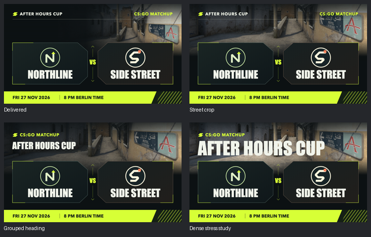

# Spacing a head-to-head card

The organizer noticed the dark area above Northline after the delivered card passed its earlier review. The reviewer had verified the team names and whether the Dust II sign remained visible. Both checks could pass while the left half of the composition still felt unfinished.

## What changed the decision

| Study | Reading at 360 pixels wide |
|---|---|
| Delivered · Pair-02 | The tiny event name ends at the top rule. Below it, a nearly black strip extends to the Northline panel. The bright hotel sign pulls attention right; the strip has little connection to either the heading or the team. |
| Street crop · Street-03 | Extending the existing scene across the width gives the eye a path along the pavement. The small labels remain stranded at opposite ends of the top rule. |
| Grouped heading · Pair-03 | The game label and event name form one left-aligned group against the subdued wall. Across from them, the street sign identifies the game world. The larger team names anchor the matchup, and the clear interval under the heading separates the event from the teams. This is my recommended version. |
| Dense stress study | Brightening the street and enlarging the same event title makes the title compete with the team names. The card begins to read like another announcement. Adding visual weight on the left solved the original symptom but overshot the brief. |

The selected study adds no copy or ornaments. In color and grayscale the paired team panels remain distinct. I inspected four overlapping native tiles and the closest sign-to-panel contact at 2×. The sign face clears the panel; its shadow still comes close. Compared with Pair-02, the pixels inside both badge-and-name regions and across the full schedule strip match exactly. This is a maker-reviewed revision awaiting organizer selection. [Full-size candidate](matchup-spacing.png) · [Previously delivered card](matchup.png) · [Editable versions](studio.zip)

## Basis for the review

Graphic designer Mark Boulton demonstrates how changing the space within and around a group changes its emphasis, using the same content. Getty’s art educators describe balance through the combined weight of shape, color, texture and space. Aurora Harley’s examples show how proximity changes which elements people perceive as related. These principles explain why a quiet wall can work behind a heading, while an equally dark strip between unrelated elements can look abandoned. [Boulton’s composition studies](https://alistapart.com/article/whitespace/) · [Getty’s principles of design](https://www.getty.edu/education/teachers/building_lessons/formal_analysis2.html) · [Nielsen Norman Group on proximity](https://www.nngroup.com/articles/gestalt-proximity/)

The harness applies this by judging the intended reading order at the actual viewing size. In a portrait, looking room can direct attention toward the subject’s gaze. On a dense scoreboard, a narrow gap can distinguish the score from the next player. An empty-area percentage would give the same verdict to arrangements with quite different effects.
